<div align="center">

  

  <h1>Stickly</h1>

  <p>
    <strong>Little stickers, endless expressions.</strong>
  </p>

  <p>
    A native Android application for organizing, discovering,
    and sharing personal sticker collections, combining an
    expressive Material You interface with intelligent image
    processing and local-first data management.
  </p>

  <p>
    Kotlin · Jetpack Compose · Material You · Machine Learning
  </p>

  <p>
    <a href="#about">About</a> ·
    <a href="#app-preview">Preview</a> ·
    <a href="#features">Features</a> ·
    <a href="#intelligent-search">Intelligent Search</a> ·
    <a href="#under-the-hood">Under the Hood</a> ·
    <a href="#getting-started">Getting Started</a>
  </p>

  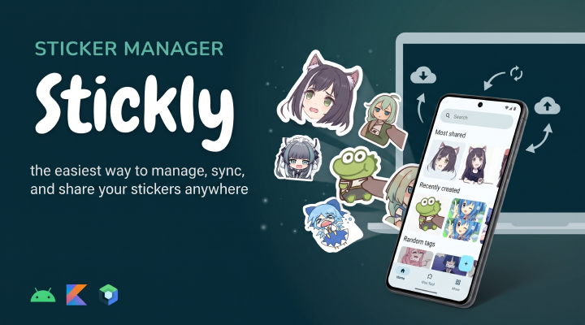

  <br />

  <sub>
    Early Works · Native Android Development · Intelligent Mobile Experiences
  </sub>

</div>

## About

Stickly is a native Android application built around a simple
idea: personal sticker collections should be easy to organize,
explore, and share.

Instead of leaving hundreds of images scattered across folders
and messaging applications, Stickly brings them together into
a searchable and customizable personal library.

The application combines manual organization, intelligent
tag suggestions, configurable search, image processing tools,
and data synchronization within a modern Android interface.

Part of my early explorations in mobile development, this
project reflects an interest in building applications that
bring together thoughtful interfaces and more advanced
computational capabilities.

It explores how local databases, machine learning, reactive
architectures, and native Android components can work together
to make everyday interactions feel more intuitive.

## App Preview

### Collect, Organize & Discover

<div align="center">

  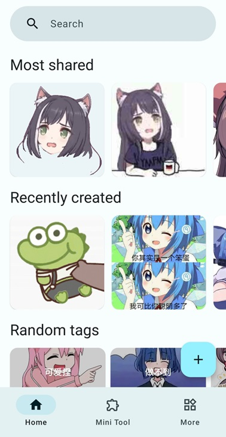
  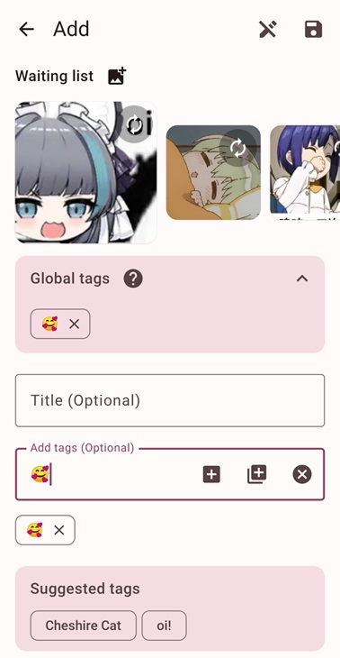
  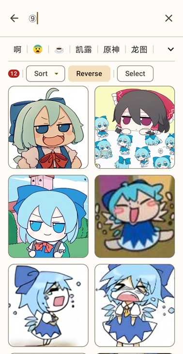

  <p>
    <sub>
      Personal collection · Sticker organization · Intelligent discovery
    </sub>
  </p>

</div>

The home screen provides quick access to frequently shared
stickers, recently added content, and existing tags.

Stickers can be imported individually or in batches,
organized through custom labels, and retrieved using
configurable search criteria.

### Make It Your Own

<div align="center">

  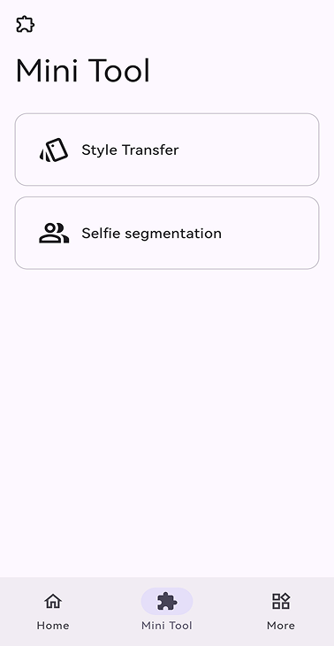
  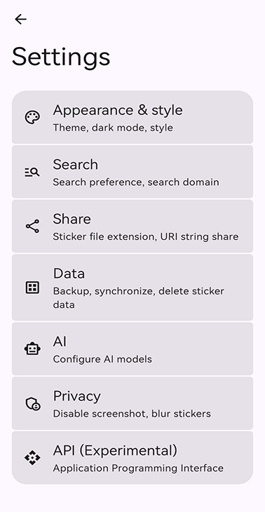
  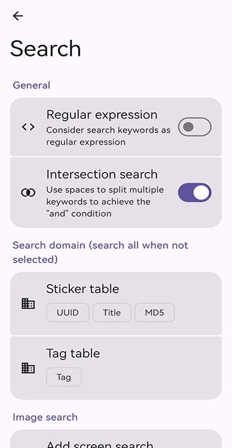

  <p>
    <sub>
      Creative tools · Personalization · Advanced search
    </sub>
  </p>

</div>

Stickly combines the expressive visual language of
Material You with configurable application behavior.

Users can customize the appearance, search preferences,
sharing behavior, and available image processing tools
according to their own workflow.

### Your Collection, Your Data

<div align="center">

  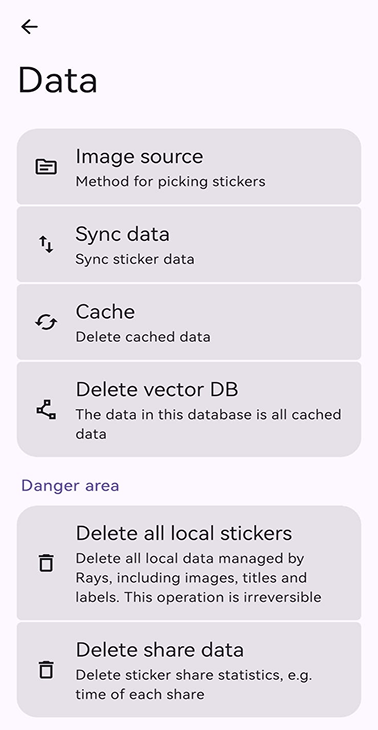
  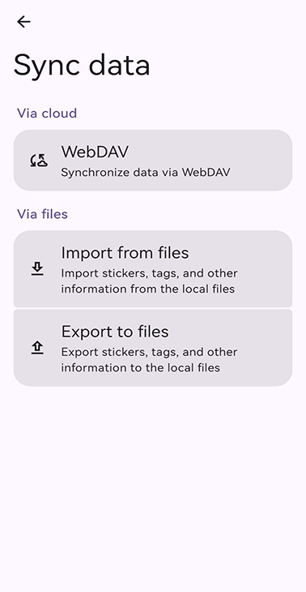
  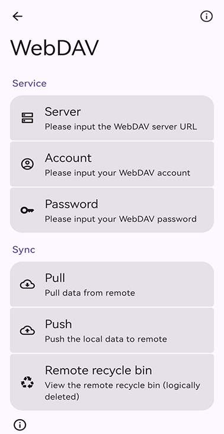

  <p>
    <sub>
      Local data management · Portable backups · WebDAV synchronization
    </sub>
  </p>

</div>

Sticker collections are maintained locally, with additional
options for importing, exporting, and synchronizing data
through a user-configured WebDAV service.

This architecture allows the core sticker library to operate
without depending on a dedicated application backend.

## Features

| Feature | Description |
| :--- | :--- |
| **Personal Sticker Library** | Collect and organize stickers within a dedicated mobile application. |
| **Batch Import** | Import multiple images and assign individual or shared tags. |
| **Smart Organization** | Browse recently created, frequently shared, and categorized stickers. |
| **Advanced Search** | Retrieve stickers using configurable metadata fields and search criteria. |
| **Regular Expressions** | Perform pattern-based searches across sticker metadata. |
| **Intersection Search** | Combine multiple keywords to refine search results. |
| **Image Similarity** | Vector-based retrieval of visually related stickers. |
| **Intelligent Tagging** | Generate suggested tags through image classification. |
| **Text Recognition** | Extract textual information from sticker images using OCR. |
| **Sticker Sharing** | Integrate sticker sharing with the native Android share sheet. |
| **Sticker Merging** | Combine multiple sticker images into a new composition. |
| **Style Transfer** | Experimental neural image transformation tools. |
| **Selfie Segmentation** | Separate foreground subjects from image backgrounds. |
| **Material You** | Dynamic colors, customizable themes, and dark mode. |
| **WebDAV Synchronization** | Push and pull sticker collections through a configured remote service. |
| **Import & Export** | Transfer stickers, tags, and associated information through local files. |

> [!NOTE]
> Image similarity, default AI classification, and neural style
> transfer require model assets that are not included in the
> current checkout. See [Machine Learning Assets](#machine-learning-assets).

## Intelligent Search

Finding the right sticker becomes increasingly difficult
as a personal collection grows.

Stickly explores two complementary approaches to
information retrieval: metadata-based search and
visual similarity search.

### Metadata Search

The application supports configurable search domains,
allowing queries to target specific database fields.

| Search Domain | Description |
| :--- | :--- |
| Title | User-defined sticker titles. |
| Tags | Labels associated with individual stickers. |
| UUID | Unique sticker identifiers. |
| MD5 | Image content hashes stored in sticker metadata. |

Search behavior can be configured through:

- Keyword matching.
- Regular expressions.
- Multiple-keyword intersection.
- Configurable sorting and reverse ordering.
- Domain-specific filtering.

### Search Examples

| Objective | Query | Search Mode |
| :--- | :--- | :--- |
| Find stickers containing "cat" | `cat` | Standard |
| Find stickers associated with both keywords | `cat happy` | Intersection |
| Find an exact metadata value | `^cat$` | Regular expression |
| Find either keyword | `.*cat.*\|.*dog.*` | Regular expression |
| Find content beginning with a keyword | `^happy.*` | Regular expression |

Intersection search must be enabled when combining
space-separated keywords.

### Visual Similarity

Beyond conventional metadata search, Stickly includes
an image retrieval pipeline based on numerical
representations of visual content.

Images are processed through a MediaPipe image embedder
to generate feature vectors.

Each sticker embedding is associated with its unique
identifier and stored in an ObjectBox vector database.

The database uses a Hierarchical Navigable Small World
(HNSW) index for approximate nearest-neighbor retrieval.

| Vector Index Configuration | Value |
| :--- | ---: |
| Embedding dimensions | 1,024 |
| Index algorithm | HNSW |
| Neighbors per node | 128 |
| Indexing search count | 400 |
| Embedding representation | FloatArray |
| Vector database | ObjectBox |

Previously generated embeddings are cached to avoid
reprocessing the entire sticker collection during
every visual search.

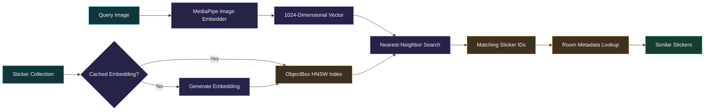

This approach makes it possible to retrieve visually
related images without relying exclusively on manually
assigned labels.

The pipeline requires a compatible image embedding
model to be available at runtime.

Source:
[`ImageSearchRepository.kt`](./app/src/main/java/com/skyd/rays/model/respository/ImageSearchRepository.kt)

## Image Intelligence

Stickly incorporates machine learning and computer
vision capabilities as complementary tools for
sticker organization and creative experimentation.

| Capability | Implementation |
| :--- | :--- |
| **Optical Character Recognition** | ML Kit text recognition. |
| **Image Classification** | Configurable image-labeling models. |
| **Tag Recommendations** | Combine recognized text and classification results. |
| **Visual Embeddings** | MediaPipe Image Embedder. |
| **Similarity Retrieval** | ObjectBox HNSW vector indexing. |
| **Foreground Segmentation** | ML Kit Selfie Segmentation. |
| **Neural Style Transfer** | LiteRT model inference. |

### Automatic Tag Suggestions

During sticker import, the application can analyze
image content to generate suggested labels.

The implementation combines two independent
processing operations:

- Text recognition to extract visible textual content.
- Image classification to identify visual categories.

The resulting suggestions are combined into a set
of candidate tags that can be incorporated into
the sticker's metadata.

Confidence thresholds and classification models
can be configured through application preferences.

Text recognition supports Latin, Chinese, Japanese,
and Korean scripts.

### Creative Image Tools

The Mini Tool section includes experimental
image-processing workflows.

**Style Transfer**

Applies visual characteristics from a reference
style image to another image through a neural
prediction and transformation pipeline.

**Selfie Segmentation**

Separates foreground subjects from their backgrounds,
providing a foundation for image compositing and
sticker creation.

These tools complement the application's primary
purpose of managing and discovering stickers.

## Under the Hood

Stickly uses a reactive Android architecture based
on the Model-View-Intent pattern.

The architecture separates interface rendering,
user actions, state transitions, application
repositories, and persistence mechanisms.

### Reactive Architecture

Each major application screen defines its own
interaction and state contracts.

| Component | Responsibility |
| :--- | :--- |
| `Intent` | Represents user actions and screen requests. |
| `State` | Describes the current observable UI state. |
| `PartialStateChange` | Represents individual state transitions. |
| `Event` | Handles transient interface events. |
| `ViewModel` | Coordinates application operations and state changes. |
| `Repository` | Manages data access and computational operations. |
| `Screen` | Renders the interface through Jetpack Compose. |

The shared MVI infrastructure is implemented in
[`AbstractMviViewModel.kt`](./app/src/main/java/com/skyd/rays/base/mvi/AbstractMviViewModel.kt).

Kotlin Coroutines and Flow connect asynchronous
repository operations with the declarative interface.

### Local Data Architecture

Stickly uses different storage mechanisms according
to the nature of the information being managed.

| Storage Component | Responsibility |
| :--- | :--- |
| **Room / SQLite** | Sticker metadata, tags, search domains, and sharing history. |
| **ObjectBox** | Cached image embeddings and vector similarity queries. |
| **DataStore** | Application preferences and persistent configuration. |
| **Local Files** | Sticker image assets and compatible model resources. |
| **Encrypted Preferences** | Storage of selected sensitive configuration values. |
| **WebDAV** | Optional remote synchronization. |

The Room database uses schema version 8 and includes
explicit migrations between previous schema versions.

Paging is used to support incremental loading of
sticker collections and search results.

### Dependency Injection

Koin coordinates the initialization and distribution
of application dependencies.

The dependency modules separate:

- Database configuration.
- Input and output resources.
- Repositories.
- ViewModels.
- Paging configuration.

This allows the presentation layer to interact
with application services without directly managing
their construction.

## Data Synchronization

Stickly is designed around a local-first collection
management workflow.

The primary sticker library, metadata, search
configuration, and image assets are maintained
on the device.

### WebDAV

The optional WebDAV integration provides explicit
push and pull operations between the local
collection and a configured remote server.

The application includes:

- Custom WebDAV server configuration.
- Account-based authentication.
- Local-to-remote synchronization.
- Remote-to-local synchronization.
- A remote recycle bin for logically deleted items.

A compatible WebDAV server is required to use
these synchronization features.

Use a trusted HTTPS endpoint when configuring
remote storage.

### Import and Export

Sticker collections can also be transferred
through local files.

The import and export implementation handles
stickers, tags, and associated application data,
providing an alternative to remote synchronization.

## Technology Stack

| Technology | Responsibility |
| :--- | :--- |
| **Kotlin** | Native Android application development. |
| **Jetpack Compose** | Declarative user interfaces. |
| **Material 3 / Material You** | Dynamic colors and expressive interface design. |
| **MVI** | Intent-driven reactive application architecture. |
| **Coroutines & Flow** | Asynchronous operations and reactive streams. |
| **Koin** | Dependency injection. |
| **Room** | Structured relational persistence. |
| **ObjectBox** | Vector storage and HNSW similarity search. |
| **Paging 3** | Incremental collection and search-result loading. |
| **DataStore** | Persistent application preferences. |
| **MediaPipe** | Image embedding generation. |
| **ML Kit** | Text recognition, classification, and segmentation. |
| **LiteRT** | Machine learning model inference. |
| **Coil** | Image loading and rendering. |
| **Retrofit & OkHttp** | Network communication. |
| **Sardine Android** | WebDAV integration. |
| **Nix & Devenv** | Reproducible Android development environment. |

### Platform Configuration

| Property | Configuration |
| :--- | :--- |
| Platform | Native Android |
| Minimum Android Version | Android 7.0 — API 24 |
| Compile SDK | 35 |
| Target SDK | 35 |
| Kotlin | 2.1.21 |
| Jetpack Compose | 1.8.3 |
| Material 3 | 1.4.0-alpha16 |
| Android Gradle Plugin | 8.10.1 |
| Gradle | 8.13 |
| JDK | 17 |
| Room | 2.7.2 |
| ObjectBox | 4.0.3 |
| Koin | 4.0.4 |
| Application Version | 2.4-alpha04 |

Dependency versions are managed through the Gradle
version catalog:

[`gradle/libs.versions.toml`](./gradle/libs.versions.toml)

## Getting Started

### Requirements

- JDK 17.
- Android SDK Platform 35.
- Android Build Tools 35.0.0.
- Git.
- Android device or emulator running API 24 or newer.
- Android Studio or Nix with Devenv.

### Clone the Repository

```bash
git clone https://github.com/4beru/stickly-android-app.git

cd stickly-android-app
```

Repository access is required while the project
remains private.

### Android Studio

1. Open the repository in Android Studio.
2. Configure JDK 17 and Android SDK 35.
3. Copy `secret.gradle.kts.example` to `secret.gradle.kts`.
4. Synchronize the Gradle project.
5. Select the `GitHubDebug` build variant.
6. Run the application on a compatible Android device.

Release signing credentials are not required
for the debug build.

### Development with Nix

The repository includes a reproducible development
environment powered by Nix and Devenv.

The configuration provides the Android SDK,
Java toolchain, platform tools, and a compatible
AAPT2 executable without requiring a manually
managed Android SDK installation.

Enter the development environment:

```bash
devenv shell
```

Prepare the local Gradle configuration:

```bash
cp -n secret.gradle.kts.example secret.gradle.kts
```

The template contains the configuration structure
required by the Gradle build scripts.

Validate the development environment:

```bash
devenv test
```

Build the application and execute the available
unit test:

```bash
./gradlew --no-daemon --max-workers=2 \
    :app:assembleGitHubDebug \
    :app:testGitHubDebugUnitTest
```

The generated universal APK is available at:

```text
app/build/outputs/apk/GitHub/debug/
└── Rays_2.4-alpha04_universal_debug_GitHub.apk
```

The build also generates architecture-specific
APKs for the configured Android ABIs.

### Run on a Physical Device

Connect an Android device with USB debugging enabled.

Verify the connection:

```bash
adb devices -l
```

Install the debug application:

```bash
./gradlew --no-daemon --max-workers=2 \
    :app:installGitHubDebug
```

The existing debug application identifier is:

```text
com.skyd.rays.debug
```

The project currently retains its original internal
package identifiers and generated APK naming scheme.

For additional environment configuration,
validation details, and troubleshooting, see:

[Local Development Guide](./docs/DEVELOPMENT.md)

## Machine Learning Assets

Some machine learning capabilities require additional
model assets that are not included in the current
repository.

| Expected Asset | Capability |
| :--- | :--- |
| `stickerclassification/sticker_classification.tflite` | Default sticker classification and tag recommendations. |
| `mobilenet_v3_small.tflite` | Image embeddings and visual similarity search. |
| `predict_int8.tflite` | Style prediction using INT8 inference. |
| `transfer_int8.tflite` | Style transformation using INT8 inference. |
| `predict_float16.tflite` | Style prediction using FLOAT16 inference. |
| `transfer_float16.tflite` | Style transformation using FLOAT16 inference. |

The application expects these resources under:

```text
app/src/main/assets/
```

Only compatible and appropriately licensed models
should be used.

The absence of these assets does not necessarily
prevent the Android application from compiling,
but it limits the corresponding runtime features.

A successful Gradle build should not be interpreted
as validation of every machine learning capability.

---

<div align="center">

  <h3>Collect what makes you smile.</h3>

  <p>
    Part of my <strong>Early Works</strong> — a collection
    of experiments, first ideas, and creative projects
    that shaped my journey as a software developer.
  </p>

  <p>
    <sub>Curated by Abel Ortega.</sub>
  </p>

  <a href="https://github.com/4beru">GitHub</a> ·
  <a href="https://www.aberu.site">Portfolio</a>

</div>
